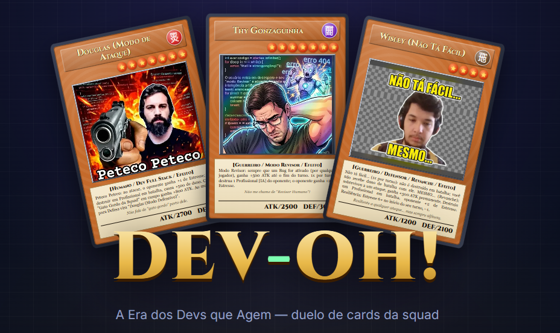
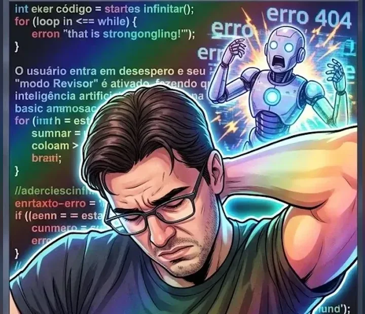
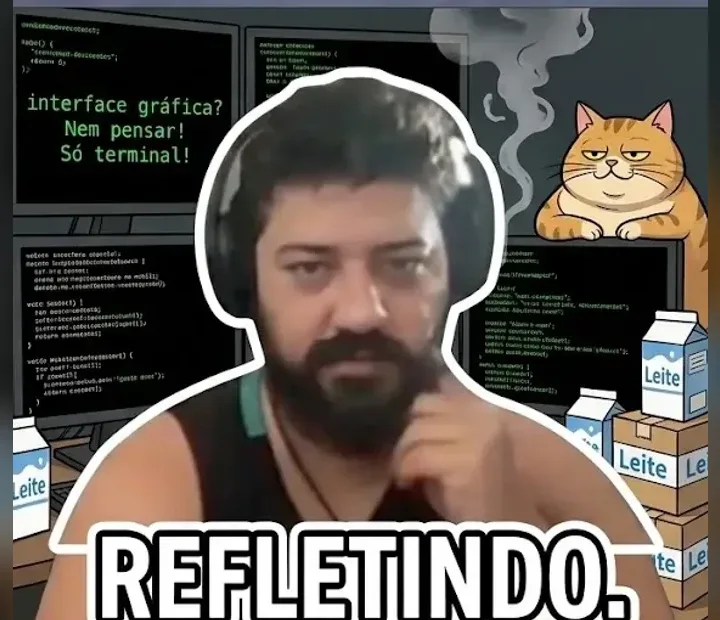
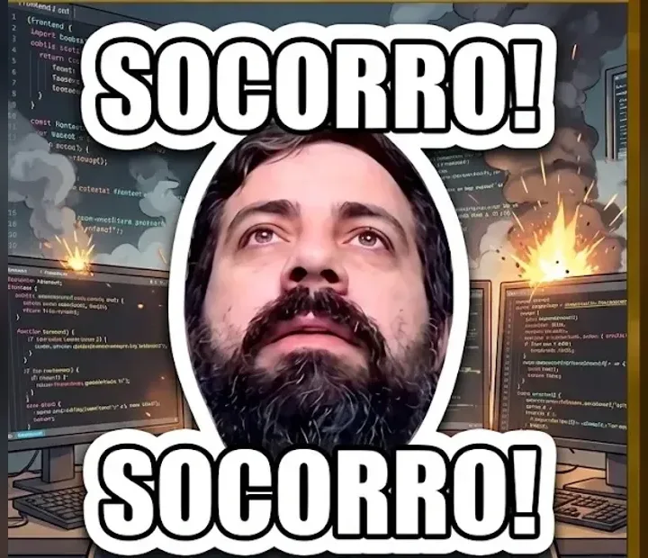
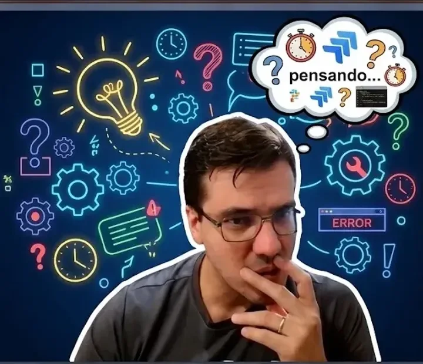

**O duelo de cards em que a sua squad é o deck.** 
Invoque os devs, ative Tasks, arme Bugs e entregue a Sprint antes que o servidor caia.

---

## 🃏 O jogo

Prazo estourando, IA alucinando, reunião que podia ser um e-mail e deploy marcado pra sexta às 17h50. **DEV-OH!** transforma o caos do dia a dia de uma equipe de desenvolvimento num duelo de cards clássico, com molduras, estrelas de nível, ATK/DEF e caixas de efeito.

Os monstros aqui são **Profissionais**: as pessoas reais da squad, com as caras cansadas de call e habilidades tiradas das piadas internas. O Thy entra em **Modo Revisor** quando a IA faz cagada. O Douglas puxa a arma no **"Peteco Peteco"** e, quando aperta, se esconde no **"SOCORRO! SOCORRO!"**. A Patrícia fica **"passada, chocada"** e paralisa o oponente. E o Wisley é resiliente a qualquer ataque, mas nunca deixa de alfinetar: "não tá fácil… MESMO."

## 🎯 O propósito

Feito **pela squad, para a squad**: um jeito de rir junto da rotina de quem vive no modo sobrevivência do desenvolvimento de software, num jogo que dá pra jogar no intervalo, no fim da daily ou depois daquele deploy que deu certo (por milagre).

Sem instalar nada, sem cadastro: abre o link, escolhe um apelido e duela.

## ✨ Destaques

- ⚔️ **PvP online em tempo real**: crie uma sala e mande o link `?sala=CODIGO` pro colega.
- 🤖 **Treino contra o bot** em duas dificuldades: **Com IA** (normal, aceita a primeira sugestão do autocomplete) e **Sem IA** (difícil, pensa cada jogada na raça).
- 😤 **Mecânica de Estresse**: quanto mais caos, mais ATK… até alguém pedir demissão.
- 🛠️ **Deck builder**: monte o seu time ou use um dos 3 decks prontos.
- 📖 **Coleção completa** com todos os cards e efeitos.
- 📱 **Funciona no celular**, na tela da firma e na TV da sala de reunião.
- 🔌 **Caiu da call?** Volte para o duelo de onde parou.

## 👥 O elenco

<table>
  <tr>
    <td align="center" width="25%"> <b>Thy Gonzaguinha</b> "Não me chame de Revisor Humano!"</td>
    <td align="center" width="25%"> <b>Douglas (Modo de Ataque)</b> Peteco Peteco.</td>
    <td align="center" width="25%"> <b>Patrícia</b> "EU TÔ PASSADA, CHOCADA!!!"</td>
    <td align="center" width="25%"> <b>Wisley</b> "Não tá fácil… MESMO."</td>
  </tr>
  <tr>
    <td align="center"> <b>Danilo (DEV Raiz)</b> "Interface gráfica? Nem pensar!"</td>
    <td align="center"> <b>Kelly</b> "CUIDADO…"</td>
    <td align="center"> <b>Vitor (O Mochileiro)</b> "Eu sei o que você fez."</td>
    <td align="center"> <b>Moisés do Jiu-Jitsu</b> "Eu não tô suportando mais…"</td>
  </tr>
  <tr>
    <td align="center"> <b>Douglas (Modo Defensivo)</b> "SOCORRO! SOCORRO!"</td>
    <td align="center"> <b>Gama</b> Babado forte!</td>
    <td align="center"> <b>Paquito Erótico</b> ♪ Prepara o coração… ♪</td>
    <td align="center"> <b>Thy (O Filósofo do Prazo)</b> "É a entropia sistêmica do back-end."</td>
  </tr>
  <tr>
    <td align="center"> <b>Douglas (No Limite)</b> "Calma… respira… não infarta!"</td>
    <td align="center"> <b>Douglas (Dois Tipos de Problemas)</b> "O meu e o seu."</td>
    <td align="center"> <b>Thy (Tech Lead)</b> "LÁ ELE!"</td>
    <td align="center"> <b>O Gato Gordo da Squad</b> Contemplai.</td>
  </tr>
</table>

…e ainda <b>A Curiosa Caótica</b>, IAs alucinando, o PO do "só um botãozinho", o Cliente que Mudou de Ideia e mais.

## 🎮 Como jogar

1. **Abra o jogo**, escolha um apelido e um deck.
2. **Treine contra o bot** ou **crie uma sala** e mande o link pro colega.
3. No seu turno, **invoque um Profissional**, ative **Tasks** e baixe **Bugs** virados.
4. Clique em **⚔ Batalha**, escolha quem ataca e o alvo.
5. **Zere os 4000 LP** do oponente (ou deixe o backlog dele acabar) para entregar a Sprint.

### Os tipos de card

| | Tipo | O que faz |
|:-:|---|---|
| 🟧 | **Profissional** | Os devs da squad. Atacam e defendem com ATK/DEF. Nível 5–6 precisa de 1 sacrifício; nível 7+ precisa de 2. |
| 🟩 | **Task** | Magias ativadas da mão: Café Extra Forte, Home Office, Refatoração Holística, Deploy na Sexta-Feira… |
| 🟪 | **Bug** | Armadilhas viradas que disparam sozinhas: A IA Fez Cagada, Merge Conflict, Erro 404, Prod Caiu… |

### 😤 Estresse: a regra da casa

Cada jogador tem uma barra de **Estresse de 0 a 10**. Bugs, reuniões e dano de batalha enchem a barra, e cada ponto dá **+100 de ATK** aos seus Profissionais (o famoso *Modo Desespero*). Mas se chegar a **10**, o seu Profissional mais forte **pede demissão**. Café e Home Office ajudam a respirar.

### 🚀 Deploy na Sexta-Feira

O card de mais alto risco do jogo: cara ou coroa. **Cara**, 3000 de dano no oponente. **Coroa**, todo o seu campo cai junto com a produção.

## 🗂️ Decks prontos

| Deck | Estilo |
|---|---|
| **Squad do Tech Lead** | Três versões do Thy, Vitor chamando na DM e IAs para revisar. Controle e paciência. |
| **Força Bruta Douglas** | Todas as formas do Douglas, o Gato Gordo e o leite do Danilo. Agressivo e arriscado. |
| **Fofoca & Caos** | Patrícia e Gama chocados, a Curiosa Caótica e IAs alucinando. Ninguém sabe o que vem. |

---

**[▶ Jogar agora](https://devohweb.up.railway.app)** · **[Guia do desenvolvedor](DEVELOPER.md)**

Feito com café, ranço leve e muito "na minha máquina funciona".

